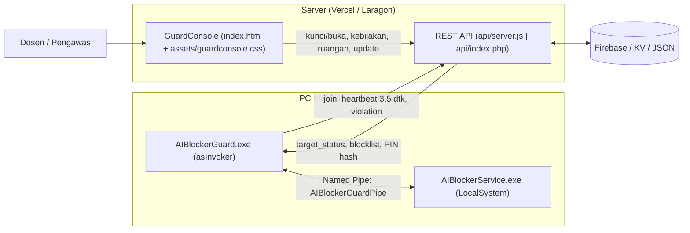

<div align="center">

# GuardConsole & GuardAgent

**Sistem pengawasan ujian laboratorium untuk memblokir akses AI, ekstensi IDE, dan game di PC mahasiswa, dikendalikan terpusat dari satu konsol web.**

[](./dist/AIBlockerSetup.exe)
[](#kompilasi-ulang-client)
[](#kompilasi-ulang-client)
[](#struktur-proyek)
[](#arsitektur)

[Buka Dashboard](https://blockai-wheat.vercel.app/) · [Unduh Installer](./dist/AIBlockerSetup.exe) · [Arsitektur](#arsitektur) · [Alur Penggunaan](#alur-penggunaan) · [Kompilasi](#kompilasi-ulang-client) · [Troubleshooting](#troubleshooting)

</div>

---

## Ringkasan Sistem

Saat ujian pemrograman berlangsung, peserta dapat mengakses chatbot AI di browser, asisten kode di VS Code, AI IDE terpisah seperti Cursor, atau menjalankan model LLM lokal. **GuardConsole** (konsol web pengawas) dan **GuardAgent** (agen desktop Windows) menutup celah tersebut secara bersamaan, sementara pengawas cukup mengelola kunci ruangan dan kebijakan blokir dari satu panel web.

| Kapabilitas | Keterangan |
|---|---|
| **Manajemen Ruangan & PIN Otorisasi** | Admin membuat ruangan secara dinamis beserta **PIN keluar/buka kunci** khusus per ruangan yang diverifikasi server dan didukung hash PBKDF2 untuk mode offline. |
| **Kebijakan Blokir Fleksibel** | Daftar domain, proses, dan ekstensi IDE dapat diterapkan secara **global** maupun **khusus per ruangan**, lengkap dengan sakelar cepat AI Chat dan Ekstensi IDE. |
| **Kendali Kunci & Update Jarak Jauh** | Kunci atau buka kunci per PC, per ruangan, maupun seluruh ruangan secara real-time, serta kirim perintah **Remote Update** langsung ke agen. |
| **Arsitektur Service Tanpa Pop-up UAC** | `AIBlockerGuard.exe` berjalan sebagai `asInvoker` di akun standar mahasiswa dan mendelegasikan aksi sistem ke Windows Service `AIBlockerGuardService` (`LocalSystem`) melalui Named Pipe. |
| **Sinkronisasi Cloud & Mode Lokal** | Mendukung deployment serverless Vercel (Node.js + Firebase / Upstash KV) dan server lokal Laragon (PHP + JSON). |
| **Antarmuka Terpadu (Light & Dark)** | Dashboard web responsif desktop/mobile, installer `AIBlockerSetup.exe`, dan panel desktop `GuardAgent` menggunakan bahasa visual dan dukungan tema Terang/Gelap yang konsisten. |

---

## Arsitektur



**Alur sinkronisasi dan eksekusi:**
1. Agen mengirim `heartbeat` setiap sekitar `3,5` detik berisi status kunci lokal, jumlah karantina ekstensi, counter proses yang dihentikan, dan status deteksi VPN.
2. Server membalas dengan `target_status` (`LOCKED` / `UNLOCKED`), hash PIN ruangan, serta kebijakan blocklist efektif untuk ruangan terkait; stempel waktu `cmd_updated_at` memastikan heartbeat PC tidak pernah menimpa perintah Admin terbaru.
3. Operasi sistem (modifikasi file `hosts`, kebijakan browser `HKLM`, karantina ekstensi, dan self-update) dijalankan oleh `AIBlockerService.exe` berhak `LocalSystem` melalui `AIBlockerGuardPipe`, sehingga akun mahasiswa biasa tidak terkena pop-up UAC.

---

## 5 Lapisan Proteksi

<details open>
<summary><strong>Layer 1: Hosts &amp; DNS Guard</strong></summary>

- Mengarahkan `187` domain bawaan AI dan game ke `0.0.0.0` melalui file `hosts` Windows (ChatGPT, Claude, Gemini, DeepSeek, Perplexity, Copilot, Cursor, Codeium, OpenRouter, Roblox, dan layanan terkait).
- **Integrity watcher** memeriksa konsistensi `hosts` setiap `2,5` detik saat terkunci; perubahan tidak sah langsung ditimpa ulang dan dicatat sebagai insiden ke dashboard.
- Setiap pergantian kunci memicu `ipconfig /flushdns` serta me-reset proses jaringan browser (`NetworkService`) agar koneksi HTTP/2 dan QUIC yang terlanjur terbuka langsung terputus tanpa menutup tab/jendela utama.
</details>

<details>
<summary><strong>Layer 2: Kebijakan Browser (Chrome, Edge, Brave)</strong></summary>

- Menuliskan daftar domain aktif ke kebijakan **`URLBlocklist`** sehingga halaman yang diakses menampilkan `ERR_BLOCKED_BY_ADMINISTRATOR`.
- Menonaktifkan **DNS-over-HTTPS (DoH)**, DNS internal browser (`BuiltInDnsClientEnabled`), dan protokol **QUIC** agar aturan `hosts` tidak dilewati.
- Menonaktifkan fitur AI bawaan browser: Gemini (Chrome), Copilot Sidebar (Edge), Leo AI (Brave), dan Copilot Chat bawaan VS Code. Seluruh kebijakan dibersihkan otomatis saat kunci dibuka.
</details>

<details>
<summary><strong>Layer 3: Karantina Ekstensi IDE</strong></summary>

- Memindahkan sementara modul ekstensi AI pada VS Code dan IDE turunannya ke folder karantina aman (GitHub Copilot, Codeium, Cline, Roo Code, Continue, Tabnine, Supermaven, Amazon Q, Gemini Code Assist, Kilo Code, dan lainnya).
- Saat penguncian dibuka oleh Admin atau PIN ruangan, seluruh ekstensi dikembalikan utuh ke lokasi semula.
</details>

<details>
<summary><strong>Layer 4: Process Killer &amp; Local LLM</strong></summary>

- Memeriksa dan menghentikan paksa setiap `2,5` detik: **AI IDE** (Cursor, Windsurf, Trae, PearAI, Void), **aplikasi AI desktop** (ChatGPT, Claude, Copilot, Perplexity), **LLM lokal** (Ollama, LM Studio, Jan, GPT4All, llama.cpp, KoboldCpp, AnythingLLM, Msty), serta **Roblox** (termasuk Bloxstrap dan Fishstrap).
- Memantau port server LLM lokal: `11434`, `1234`, `1337`, dan `5001`.
</details>

<details>
<summary><strong>Layer 5: Deteksi VPN &amp; Tunnel</strong></summary>

- Mendeteksi adaptor VPN atau tunnel aktif (termasuk Cloudflare WARP) pada antarmuka jaringan Windows dan mengirimkan peringatan ke panel telemetri maupun jurnal insiden dashboard.
</details>

---

## Alur Penggunaan

### 1. Persiapan Dashboard (Dosen / Pengawas)
1. Buka konsol web di **<https://blockai-wheat.vercel.app/>** (atau `http://localhost/blockwebanaiinideforquiz/` pada Laragon lokal) lalu masuk sebagai Admin.
2. Buka menu **Ruangan & PIN Pengawas**, tambahkan **Kode Ruangan** (contoh: `LAB-701`) dan **PIN Otorisasi**.
3. *(Opsional)* Atur kebijakan domain, proses, atau ekstensi khusus pada menu **Kebijakan Blokir Fleksibel**, atau biarkan mengikuti **Kebijakan Global**.

### 2. Pemasangan Agen (PC Mahasiswa)
1. Unduh [`AIBlockerSetup.exe`](./dist/AIBlockerSetup.exe) lalu jalankan sebagai **Administrator** (hanya diperlukan sekali saat pemasangan untuk mendaftarkan Windows Service `AIBlockerGuardService`).
2. Tentukan direktori tujuan dan opsi konfigurasi di installer, lalu klik **Pasang Agen**.
3. Setelah **GuardAgent** terbuka, isi **NIM / ID Perangkat** dan **Nama Peserta / Nama PC Lab**, pilih kode ruangan pada dropdown **Ruangan Sesi**, lalu klik **Hubungkan ke Ruangan & Sinkronkan Server**.

### 3. Operasi Saat Ujian

| Aksi | Cara |
|---|---|
| Kunci semua atau satu ruangan | Gunakan sakelar global di header konsol atau tombol kunci pada halaman **Ruangan & PIN Pengawas** |
| Kunci satu perangkat mahasiswa | Klik tombol **Kunci** pada baris perangkat di tab **Perangkat Mahasiswa** |
| Buka kunci perangkat / sesi | Klik tombol **Buka** dari konsol web, atau gunakan tombol **Buka Kunci Darurat (PIN Ruangan)** pada panel agen |
| Ubah daftar domain / proses / ekstensi | Buka tab **Kebijakan Blokir Fleksibel**, pilih cakupan global atau ruangan, lalu simpan (sinkron otomatis ke PC terkunci) |
| Perbarui agen jarak jauh (Remote Update) | Kirim instruksi **Update** dari konsol Admin untuk memperbarui `AIBlockerGuard.exe` secara otomatis |
| Pantau pelanggaran & insiden | Buka tab **Log Audit & Insiden** |

> [!TIP]
> PIN otorisasi tiap ruangan dapat dilihat dan disalin langsung dari menu **Ruangan & PIN Pengawas**. Bagikan PIN hanya kepada pengawas atau saat peserta selesai dan diizinkan keluar sesi.

---

## Paket Distribusi

| File | Hak Akses | Fungsi |
|---|---|---|
| [`dist/AIBlockerSetup.exe`](./dist/AIBlockerSetup.exe) | `requireAdministrator` | **Installer utama (Direkomendasikan)**: menanamkan `AIBlockerService.exe` dan `AIBlockerGuard.exe`, mengatur izin `ProgramData`, mendaftarkan Windows Service `AIBlockerGuardService`, membuat `Restore-Normal.bat`, serta mengonfigurasi auto-start dan pintasan desktop. |
| [`dist/AIBlockerGuard.exe`](./dist/AIBlockerGuard.exe) | `asInvoker` | **Panel desktop & system tray agen (`v1.6.0`)**: antarmuka kontrol peserta, sinkronisasi server, dialog verifikasi PIN, dan pemantauan lokal 24/7. |
| [`dist/AIBlockerService.exe`](./dist/AIBlockerService.exe) | `LocalSystem` | **Windows Service (`AIBlockerGuardService`)**: mengeksekusi penulisan `hosts`, kebijakan browser, karantina ekstensi, dan self-update lewat `AIBlockerGuardPipe` tanpa UAC. |
| [`dist/VSCodeSetup.exe`](./dist/VSCodeSetup.exe) | System Installer | **VS Code Terproteksi (`Code - OSS` x64)**: paket instalasi editor laboratorium dengan pembatasan AI Agent dan ekstensi *(disimpan via Git LFS)*. |
| [`dist/Emergency-Restore.bat`](./dist/Emergency-Restore.bat) | Administrator | **Skrip pemulihan darurat**: membersihkan blokir `hosts`, memulihkan kebijakan DNS browser, dan mengembalikan ekstensi IDE apabila perangkat mati mendadak. |

---

## Struktur Proyek

```text
blockwebanaiinideforquiz/
├── index.html                  # GuardConsole: halaman utama dashboard pengawas & halaman login
├── index.php                   # Wrapper PHP yang menyajikan index.html pada Laragon/Apache
├── assets/
│   └── guardconsole.css        # Design system Light & Dark theme konsol web
├── api/
│   ├── server.js               # REST API serverless (Vercel) + sinkronisasi Firebase / KV
│   └── index.php               # REST API versi PHP (server lokal Laragon)
├── includes/
│   └── Storage.php             # Penyimpanan JSON lokal + daftar blokir bawaan (mode PHP)
├── storage/
│   └── database.json           # State database lokal (mode PHP)
├── client-src/
│   ├── Program.cs              # Source GuardAgent panel desktop, tray, & GuardEngine (C# WinForms)
│   ├── Service.cs              # Source Windows Service AIBlockerGuardService (LocalSystem)
│   ├── Installer.cs            # Source AIBlockerSetup.exe (C# WinForms installer)
│   ├── app.manifest            # Manifest asInvoker untuk AIBlockerGuard.exe
│   └── setup.manifest          # Manifest requireAdministrator untuk AIBlockerSetup.exe
├── dist/                       # Paket biner siap distribusi & instalasi lab
├── build.ps1                   # Skrip kompilasi Service, Client, dan Setup via csc.exe (.NET 4.x)
├── vercel.json                 # Routing Vercel rewrite & header unduhan /dist/*
└── package.json                # Metadata proyek Node.js (>= 18.x)
```

---

## Deploy ke Vercel

**Via GitHub (Otomatis):**
1. Push repositori ke GitHub.
2. Import proyek di [vercel.com/new](https://vercel.com/new) lalu klik **Deploy** (tanpa perlu perintah build tambahan).
3. Setiap `git push origin main` akan memicu deployment produksi baru secara otomatis.

**Via CLI:**
```powershell
npx vercel --prod
```

Endpoint API yang digunakan oleh agen: `https://<project-anda>.vercel.app/api/index.php`

> [!NOTE]
> Penyimpanan cloud memakai **Firebase** secara bawaan. Apabila environment variable `KV_REST_API_URL` dan `KV_REST_API_TOKEN` (Upstash Redis / Vercel KV) dikonfigurasi, backend akan menggunakannya sebagai penyimpanan utama.

---

## Kompilasi Ulang Client

Membutuhkan compiler C# `.NET Framework 4.x` (`C:\Windows\Microsoft.NET\Framework64\v4.0.30319\csc.exe`, tersedia bawaan di Windows 10/11). Jalankan:

```powershell
powershell -ExecutionPolicy Bypass -File .\build.ps1
```

Skrip akan menghasilkan ketiga executable secara berurutan di folder `dist\`:
1. `dist\AIBlockerService.exe`
2. `dist\AIBlockerGuard.exe`
3. `dist\AIBlockerSetup.exe` (otomatis menanamkan biner service dan guard terbaru)

> [!IMPORTANT]
> Setelah build ulang selesai, jalankan ulang `AIBlockerSetup.exe` sebagai Administrator pada PC target (installer akan menghentikan service/proses lama secara otomatis) atau picu Remote Update dari dashboard untuk memperbarui agen yang sudah terpasang.

---

## Troubleshooting

<details>
<summary><strong>Situs AI atau Roblox masih terbuka setelah ruangan dikunci</strong></summary>

- Pastikan biner agen terbaru (`v1.6.0`) dan service `AIBlockerGuardService` sudah terpasang dengan menjalankan ulang `AIBlockerSetup.exe` sebagai Administrator.
- Tunggu satu siklus heartbeat (`3,5` detik), lalu muat ulang tab browser.
- Periksa kebijakan aktif di `edge://policy` atau `chrome://policy` dan pastikan `URLBlocklist` memuat daftar domain blokir.
</details>

<details>
<summary><strong>PC mahasiswa tidak muncul pada daftar perangkat dashboard</strong></summary>

- Pastikan kode ruangan yang dipilih di aplikasi masih terdaftar di konsol Admin (ruangan yang dihapus akan mereset pilihan ruangan pada agen).
- Periksa kembali field **Endpoint Server** di aplikasi: pastikan berakhiran `/api/index.php` dan dapat diakses dari jaringan laboratorium.
</details>

<details>
<summary><strong>Perangkat mati mendadak saat ujian sehingga hosts atau ekstensi IDE belum pulih</strong></summary>

Jalankan [`dist/Emergency-Restore.bat`](./dist/Emergency-Restore.bat) sebagai Administrator, atau eksekusi perintah berikut:

```powershell
"C:\Program Files\AIBlockerGuard\AIBlockerGuard.exe" --restore
```
</details>

<details>
<summary><strong>File AIBlockerSetup.exe hilang atau dihapus oleh Windows Defender</strong></summary>

File `.exe` custom yang belum memiliki tanda tangan digital kadang dikarantina oleh Windows Security. Periksa **Protection History** pada Windows Security, tambahkan folder `dist\` ke daftar **Exclusion** jika diperlukan, lalu pulihkan file dari Git atau build ulang:

```powershell
git checkout -- dist/AIBlockerSetup.exe
```
Atau kompilasi ulang seluruh paket dari source menggunakan `build.ps1`.
</details>

---

<div align="center">

**GuardConsole & GuardAgent** · Created by Nizan

</div>
