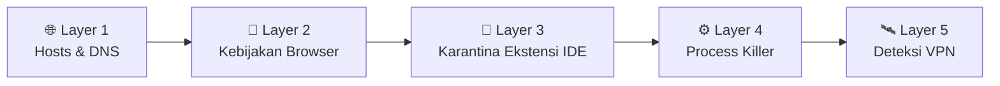
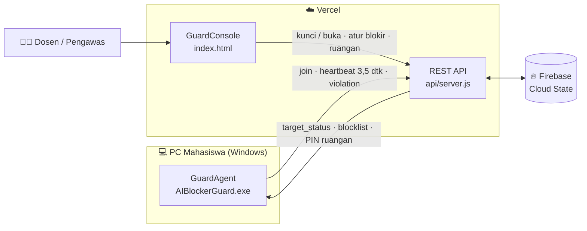

<div align="center">

# 🛡️ AI-Blocker Guard

**Sistem pengawasan ujian & kuis yang memblokir AI dan game di PC mahasiswa — dikendalikan penuh dari satu dashboard web.**

[](#-instalasi-di-pc-mahasiswa)
[](https://blockai-wheat.vercel.app/)
[](#-arsitektur)
[](#-kompilasi-ulang-client)
[](#-struktur-proyek)

[**🌐 Buka Dashboard**](https://blockai-wheat.vercel.app/) · [**⬇️ Unduh Installer**](./dist/AIBlockerSetup.exe) · [**📖 Cara Pakai**](#-alur-penggunaan) · [**🧯 Troubleshooting**](#-troubleshooting)

</div>

---

## ✨ Kenapa AI-Blocker Guard?

Saat ujian pemrograman, mahasiswa bisa membuka ChatGPT di browser, memakai Copilot di VS Code, menjalankan Cursor, atau bahkan LLM lokal seperti Ollama. **AI-Blocker Guard** menutup semua celah itu sekaligus, dan dosen cukup menekan satu tombol **Kunci** / **Buka** dari dashboard.

| | Fitur | Keterangan |
|---|---|---|
| 🏫 | **Manajemen Ruangan** | Ruangan dibuat sendiri oleh Admin (tidak ada ruangan bawaan). Setiap ruangan punya **PIN otorisasi keluar** masing-masing. |
| 🎯 | **Kebijakan Blokir per Ruangan** | Daftar domain, proses, dan ekstensi IDE bisa diatur **global** atau **khusus per ruangan**. |
| 🔒 | **Kunci / Buka Real-time** | Kunci per PC, per ruangan, atau semua ruangan. Bisa dikunci ulang kapan saja — tab yang sudah terbuka ikut terputus. |
| ☁️ | **Sinkron via Firebase** | State dashboard tersimpan di Firebase sehingga konsisten di semua instance serverless Vercel. |
| 🔑 | **Login Admin** | Dashboard web dilindungi halaman login. |
| 🎮 | **Blokir Roblox** | Domain & proses Roblox (termasuk Bloxstrap / Fishstrap) ikut diblokir. |
| 🖥️ | **Agen Selalu Aktif** | Aplikasi berjalan di tray & auto-start, tetap siaga menerima perintah Admin walau sedang tidak terkunci. |

---

## 🧱 5 Lapisan Proteksi



<details open>
<summary><b>🌐 Layer 1 — Hosts & DNS Guard</b></summary>

- Mengarahkan ±190 domain AI & game ke `0.0.0.0` lewat file `hosts` (ChatGPT, Claude, Gemini, DeepSeek, Perplexity, Copilot, Cursor, Codeium, OpenRouter, Roblox, dll).
- **Integrity watcher** setiap 2,5 detik: jika file `hosts` diubah atau jumlah domainnya tidak cocok dengan kebijakan Admin, blokir langsung ditulis ulang dan pelanggaran dilaporkan ke dashboard.
- Setiap perubahan status memicu `ipconfig /flushdns` **dan reset proses jaringan browser** (`NetworkService`) sehingga koneksi HTTP/2 & QUIC yang sudah terbuka langsung terputus — tanpa menutup jendela browser.
</details>

<details>
<summary><b>🧭 Layer 2 — Kebijakan Browser (Chrome / Edge / Brave)</b></summary>

- Menulis daftar domain ke kebijakan **`URLBlocklist`** → halaman terblokir dengan `ERR_BLOCKED_BY_ADMINISTRATOR`.
- Mematikan **DNS-over-HTTPS**, DNS internal browser (`BuiltInDnsClientEnabled`), dan **QUIC** agar blokir `hosts` tidak bisa dilewati.
- Menonaktifkan AI bawaan browser: Gemini (Chrome), Copilot Sidebar (Edge), Leo AI (Brave), serta Copilot Chat bawaan VS Code.
- Semua kebijakan dihapus otomatis saat kunci dibuka.
</details>

<details>
<summary><b>🧩 Layer 3 — Karantina Ekstensi IDE</b></summary>

- Memindahkan sementara ekstensi AI VS Code ke folder karantina: GitHub Copilot, Codeium, Cline, Roo Code, Continue, Tabnine, Supermaven, Amazon Q, Gemini Code Assist, Kilo Code, dll.
- Saat dibuka, seluruh ekstensi dikembalikan **100% seperti semula**.
</details>

<details>
<summary><b>⚙️ Layer 4 — Process Killer & Local LLM</b></summary>

- Menghentikan paksa setiap 2,5 detik: **AI IDE** (Cursor, Windsurf, Trae, PearAI, Void), **aplikasi AI desktop** (ChatGPT, Claude, Copilot, Perplexity), **LLM lokal** (Ollama, LM Studio, Jan, GPT4All, llama.cpp, KoboldCpp, AnythingLLM, Msty), dan **Roblox**.
- Memantau port LLM lokal: `11434`, `1234`, `1337`, `8080`, `5001`.
</details>

<details>
<summary><b>🛰️ Layer 5 — Deteksi VPN / Tunnel</b></summary>

- Mendeteksi adaptor VPN aktif (termasuk Cloudflare WARP) dan menampilkan peringatan **VPN_ALERT** di dashboard.
</details>

---

## 🏗️ Arsitektur



**Alur perintah:**
1. Agen mengirim `heartbeat` setiap ±3,5 detik berisi status lokal & telemetri.
2. Server membalas dengan `target_status` (`LOCKED` / `UNLOCKED`) dan **blocklist efektif** untuk ruangan tersebut.
3. Perintah Admin diberi stempel waktu `cmd_updated_at`, sehingga heartbeat dari PC **tidak pernah menimpa** perintah Kunci yang lebih baru.

---

## 🚀 Alur Penggunaan

### 1️⃣ Dosen — Siapkan Dashboard
1. Buka dashboard: **<https://blockai-wheat.vercel.app/>** (atau `http://localhost/blockwebanaiinideforquiz/` di Laragon) dan login.
2. Masuk ke menu **Ruangan** → **+ Tambah**, isi **Kode Ruangan** (mis. `LAB-701`) dan **PIN Otorisasi**.
3. *(Opsional)* Klik **Atur Blokir** pada ruangan untuk membuat kebijakan khusus, atau biarkan mengikuti **Kebijakan Global**.

### 2️⃣ Mahasiswa — Pasang Agen
1. Unduh [`AIBlockerSetup.exe`](./dist/AIBlockerSetup.exe) → klik kanan → **Run as administrator**.
2. Isi **NIM**, **Nama**, lalu **pilih ruangan** dari daftar yang dibuat dosen.
3. Agen akan berjalan di system tray dan otomatis aktif saat Windows menyala.

### 3️⃣ Saat Ujian
| Aksi | Cara |
|---|---|
| 🔒 Kunci semua / satu ruangan | Tombol **Kunci** di header atau di daftar Ruangan |
| 🔒 Kunci satu PC | Tombol **Kunci** pada kartu mahasiswa |
| 🔓 Buka kunci | Tombol **Buka**, atau mahasiswa memasukkan **PIN ruangan** di aplikasi |
| 📝 Ubah domain yang diblokir | Menu **Kebijakan Blokir** → pilih ruangan → **Simpan** (langsung diterapkan ke PC yang terkunci) |
| 📋 Lihat pelanggaran | Menu **Jurnal Audit** |

> [!TIP]
> PIN tiap ruangan bisa dilihat & disalin langsung dari menu **Ruangan**. Berikan PIN hanya ketika mahasiswa memang boleh keluar.

---

## 📦 Paket Distribusi

| File | Fungsi |
|---|---|
| [`dist/AIBlockerSetup.exe`](./dist/AIBlockerSetup.exe) | **Installer** — memasang agen ke `C:\Program Files\AIBlockerGuard\` + auto-start. *(Direkomendasikan)* |
| [`dist/AIBlockerGuard.exe`](./dist/AIBlockerGuard.exe) | **Portable** — satu file, langsung jalan sebagai Administrator. |
| [`dist/Emergency-Restore.bat`](./dist/Emergency-Restore.bat) | **Pemulihan darurat** — membersihkan `hosts`, kebijakan browser, dan mengembalikan ekstensi IDE. |

---

## 🗂️ Struktur Proyek

```text
blockwebanaiinideforquiz/
├── index.html / index.php     # GuardConsole — dashboard pengawas (login, ruangan, monitor, kebijakan, audit)
├── api/
│   ├── server.js              # REST API serverless (Vercel) + sinkronisasi Firebase
│   └── index.php              # REST API versi PHP (Laragon / lokal)
├── includes/Storage.php       # Penyimpanan JSON lokal + daftar blokir bawaan
├── storage/database.json      # Data lokal (mode PHP)
├── client-src/
│   ├── Program.cs             # Source GuardAgent (C# WinForms)
│   ├── Installer.cs           # Source installer
│   └── app.manifest           # Manifest requireAdministrator
├── dist/                      # Hasil build siap distribusi
├── build.ps1                  # Skrip kompilasi .exe
└── vercel.json / package.json # Konfigurasi deploy Vercel
```

---

## ☁️ Deploy ke Vercel

**Via GitHub (otomatis):**
1. Push repositori ke GitHub.
2. Import di [vercel.com/new](https://vercel.com/new) → **Deploy** (tanpa build command tambahan).
3. Setiap `git push origin main` akan otomatis ter-deploy ulang.

**Via CLI:**
```powershell
npx vercel --prod
```

Endpoint yang dipakai agen: `https://<project-anda>.vercel.app/api/index.php`

> [!NOTE]
> Penyimpanan state memakai **Firebase** secara default. Jika variabel `KV_REST_API_URL` & `KV_REST_API_TOKEN` (Upstash Redis / Vercel KV) tersedia, server akan memakainya sebagai penyimpanan utama.

---

## 🛠️ Kompilasi Ulang Client

Butuh .NET Framework 4.x (sudah bawaan Windows 10/11). Jalankan:

```powershell
powershell -ExecutionPolicy Bypass -File .\build.ps1
```

Hasil: `dist\AIBlockerGuard.exe` dan `dist\AIBlockerSetup.exe`.

> [!IMPORTANT]
> Setelah build ulang, **tutup GuardAgent** yang sedang berjalan lalu jalankan ulang `AIBlockerSetup.exe` sebagai Administrator agar versi baru terpasang.

---

## 🧯 Troubleshooting

<details>
<summary><b>Situs masih bisa dibuka setelah dikunci ulang</b></summary>

- Pastikan versi agen terbaru sudah terpasang (jalankan ulang installer sebagai Administrator).
- Tunggu satu siklus heartbeat (±3,5 detik), lalu refresh tab.
- Cek kebijakan aktif di browser: buka `edge://policy` atau `chrome://policy` → `URLBlocklist` harus berisi daftar domain.
</details>

<details>
<summary><b>PC tidak muncul di dashboard</b></summary>

- Pastikan ruangan yang dipilih di aplikasi **masih ada** di dashboard (ruangan yang dihapus akan meminta mahasiswa memilih ulang).
- Periksa URL server di aplikasi: harus diakhiri `/api/index.php`.
</details>

<details>
<summary><b>PC mati saat ujian & internet/ekstensi tidak normal</b></summary>

Jalankan [`Emergency-Restore.bat`](./dist/Emergency-Restore.bat) sebagai Administrator, atau:

```powershell
"C:\Program Files\AIBlockerGuard\AIBlockerGuard.exe" --restore
```
</details>

---

<div align="center">

Dibuat untuk menjaga **integritas akademik** di laboratorium komputer. 🎓

</div>
